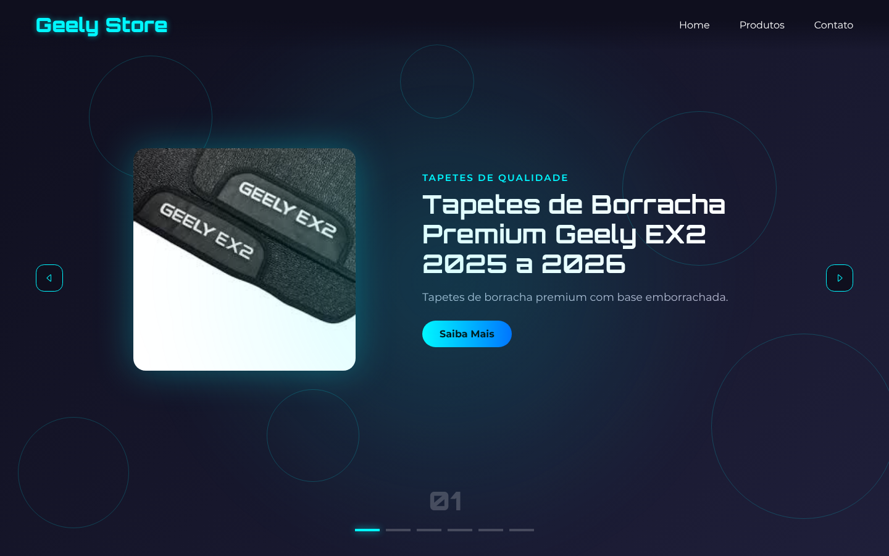
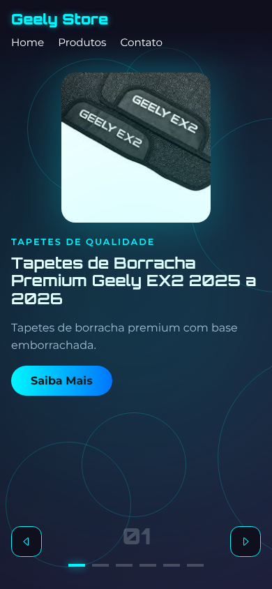

# Geely Store · DevStore

Vitrine online de **acessórios para o carro elétrico Geely EX2**, feita com HTML, CSS e JavaScript puros. A página apresenta os produtos em um **carrossel animado** com visual tecnológico: fundo escuro, detalhes em azul neon e círculos decorativos.

🔗 **Ver o site:** https://elsondev-backend.github.io/DevStore/



## Sobre o projeto

A Geely Store é uma landing page de produtos. Cada slide do carrossel mostra um acessório com:

- **foto** do produto;
- **categoria** (ex.: "Capa de chave", "Tapetes de qualidade");
- **nome** e **descrição curta**;
- botão **Saiba Mais**;
- texto detalhado com as características do produto.

Os slides trocam sozinhos a cada **5 segundos**, e o visitante também pode navegar pelas **setas** laterais. Na parte de baixo, um **contador** (01, 02, 03...) e uma **barra de indicadores** mostram qual produto está na tela.

## Produtos em destaque

| # | Categoria | Produto |
|---|-----------|---------|
| 01 | Tapetes de qualidade | Tapetes de borracha Premium Geely EX2 2025/2026 |
| 02 | Capa de chave | Capa de chave Geely EX2 Max e Pro em silicone |
| 03 | Chaveiro luxo | Chaveiro em aço cromado e couro legítimo (EC7, EX2, EX5) |
| 04 | Capa de chave | Capa de chave Geome em liga de zinco e couro |
| 05 | Capa de chave | Capa de chave em couro com fivela rosa |
| 06 | Protetor de painel | Película PPF transparente antirriscos |

## Funcionalidades

- Carrossel com transição suave de deslizamento e esmaecimento.
- Troca automática de slide a cada 5 segundos, voltando ao início depois do último.
- Navegação pelas setas, pelos indicadores (clicáveis), pelas setas do teclado e deslizando o dedo no celular.
- Botão **Saiba Mais** que abre e fecha a descrição completa do produto (o carrossel pausa enquanto ela está aberta).
- Página **Home** sobre a fabricante: fundação em 1986, compra da Volvo, marcas do grupo, o EX2 e a chegada ao Brasil.
- Página **Produtos** com todos os acessórios em cartões, cada um com "Saiba Mais" e botão **Tenho interesse**.
- Página **Contato** com formulário; o botão "Tenho interesse" já chega com o produto escolhido (o envio é só demonstração).
- Contador numérico e barra de indicadores sincronizados com o slide atual.
- Fundo animado com brilho pulsante em azul neon (`@keyframes pulse`).
- **Layout responsivo**: no celular a foto fica acima do texto e as setas descem para junto dos indicadores.
- **Acessibilidade**: textos alternativos nas imagens, rótulos para leitores de tela, foco visível no teclado e respeito à opção "reduzir movimento" do sistema.



## Tecnologias

- **HTML5**: estrutura da página e dos slides.
- **CSS3**: layout com Flexbox, transições, animações, gradientes e sombras.
- **JavaScript (vanilla)**: lógica do carrossel, temporizador e indicadores.
- **Google Fonts**: Montserrat (textos) e Orbitron (logo e títulos).
- **GitHub Pages**: hospedagem.

## Estrutura de pastas

```
DevStore/
├── index.html    # Vitrine: carrossel com os 6 produtos em destaque
├── home.html     # Home: carrossel sobre a fabricante Geely (história, Volvo, marcas, EX2, Brasil)
├── produtos.html # Catálogo com todos os produtos em cartões
├── contato.html  # Formulário de contato (demonstração)
├── style.css     # Estilos, cores, animações e layout
├── script.js     # Carrossel (setas, timer, indicadores) e formulário
├── img/          # Fotos dos produtos (geely1.jpg ... geely6.jpg)
└── LICENSE       # Licença MIT
```

## Como rodar localmente

Não precisa instalar nada.

```bash
git clone https://github.com/elsondev-backend/DevStore.git
cd DevStore
```

Depois é só abrir o arquivo `index.html` no navegador (duplo clique). Se preferir, use a extensão **Live Server** do VS Code.

## Paleta de cores

| Cor | Uso |
|-----|-----|
| `#0f0f1e` | Fundo |
| `#00f7ff` | Destaques neon (logo, setas, indicadores) |
| `#0066ff` | Gradiente do botão |
| `#b8b8d0` | Textos de descrição |

## Autor

Desenvolvido por **Elson Rocha** · [github.com/elsondev-backend](https://github.com/elsondev-backend)

## Licença

Distribuído sob a licença **MIT**. Veja o arquivo [LICENSE](LICENSE).
